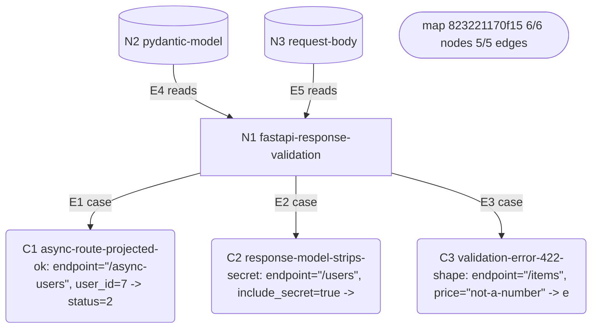

# DRIFT Real-World PR Showcase — FastAPI (Python + Pydantic v2)

This standalone showcase demonstrates **[DRIFT Free (`v0.11.0`)](https://github.com/rad-ox/drift/releases/tag/v0.11.0)** running in live GitHub Actions pull-request checks on **[FastAPI](https://github.com/fastapi/fastapi)** (MIT License, pinned upstream base `v0.165.0` / commit `05e6df7e906c`).

- **DRIFT project & release:** [rad-ox/drift (`v0.11.0`)](https://github.com/rad-ox/drift)
- **Important:** All demo PRs target this showcase repository's `main` branch only — never upstream `fastapi/fastapi`.

## What `v0.11.0` Enforces Here

- **Hardened observed policy (`.drift/config.toml`):** initialized with `drift init rad-ox . --observed`, enforcing `proof = "verified"` and `require_observations = true` (`core@1`, approved by `rad-ox`).
- **Two approved FastAPI contracts (6 cases total):**
  - `.drift/contracts/fastapi-response-validation.toml` (`fastapi-http@1` profile) — `response_model` strips undeclared secret fields (`hashed_password`, `secret_token`), Pydantic v2 returns HTTP `422` with structured `float_parsing` detail, and async ASGI endpoints preserve projected fields.
  - `.drift/contracts/fastapi-depends-literal-meta.toml` (`fastapi-depends@1` profile) — `Depends()` injects structured metadata envelopes (including literal `$t`/`$meta` keys), `dependency_overrides` replaces injected dependencies, and `HTTPException(403)` propagates cleanly.
- **Zero-vendoring Python bridge + strict input binding:** `tests/test_drift_fastapi_showcase.py` imports `drift` directly from the installed `~/.local/share/drift/bridges` (`PYTHONPATH`) and runs with `strict_when=True` / `DRIFT_STRICT_WHEN=1`, emitting `drift.observation/1` records automatically via `d.check_projection(...)` and `d.check(...)`.
- **Single-command gate + independent MIT parity check:**
  ```bash
  PYTHONPATH="$HOME/.local/share/drift/bridges:." DRIFT_STRICT_WHEN=1 \
    drift run --events .drift-work/events --gate -- \
    pytest -q tests/test_drift_fastapi_showcase.py

  drift gate .drift/contracts --events .drift-work/events --json > gate.json
  python3 verifier/drift_verify.py .drift/contracts \
    --config .drift/config.toml \
    --events .drift-work/events \
    --compare-gate gate.json --json
  ```

## Contract Map (`drift map .drift/contracts/fastapi-response-validation.toml --as mermaid`)



## Live Demo Pull Requests (against `main`)

Every PR runs two independent GitHub Actions jobs in parallel so you can compare native pytest against the DRIFT gate directly in the PR Checks panel:

1. **`Native pytest`** — Standard `pytest -q tests/test_drift_fastapi_showcase.py` execution without the DRIFT gate.
2. **`DRIFT v0.11.0 Gate + Independent MIT Verifier`** — Runs `DRIFT_STRICT_WHEN=1 drift run --events .drift-work/events --gate -- pytest` and verifies 100% verdict parity against the open MIT reference verifier (`drift_verify.py --compare-gate`).

| PR | Branch | Scenario | Native pytest | DRIFT v0.11.0 Gate + MIT Verifier |
|---|---|---|:---:|:---:|
| `#1` | `demo/false-green` | Introduces a "fast-path" `serialize_response` regression in `fastapi/routing.py` that leaks `hashed_password` and `secret_token` from `InternalUser`, and weakens `test_response_model_strips_secret` to skip `d.check_projection(...)` so native `pytest` stays green | `PASS` | **`FAIL`** (`bound`, missing observation; parity `ok: true`) |
| `#2` | `demo/valid-fix` | Legitimate helper extraction in `fastapi/routing.py` (`_serialize_validated_response`) that preserves full `response_model` validation and field filtering | `PASS` | `PASS` (`6/6 verified`; parity `ok: true`) |
| `#3` | `demo/free-limit` | **Honest DRIFT Free limit:** keeps the `serialize_response` secret-leak regression and feeds hardcoded expected literals into `d.check_projection(...)` instead of the real HTTP response | `PASS` | `PASS` (not blocked by Free alone; parity `ok: true`) |

### Honest Boundary Note on PR `#3` (`demo/free-limit`)

As documented in DRIFT's `GUARANTEES.md §1.1`, no in-process test protocol alone can stop a contributor or coding agent who has write access to the test file and deliberately feeds hardcoded expected literals into `d.check_projection(...)` without forwarding the real application output. Closing that boundary requires keeping acceptance tests outside agent write scope (`CODEOWNERS` / isolated read-only CI harness) and/or enforcing mutation proofs (`proof = "killed"` / `drift mutants`) in DRIFT Enterprise.
